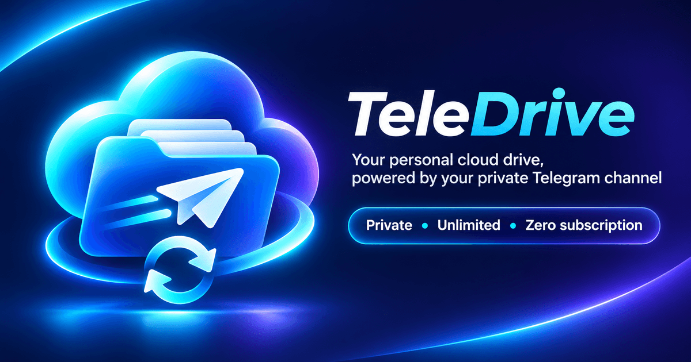

<p align="center"></p>

# TeleDrive (Telegram Drive)

Tu nube personal sobre tu canal privado de Telegram: **privada, sin límites y sin suscripción**. Instalable como **PWA** en iPhone,
Android y escritorio: carpetas, subida/descarga, música con biblioteca, vídeo, fotos con línea de tiempo y enlaces para compartir.

- **Telegram es la fuente de verdad; SQLite es solo una caché del índice** (`data/index.db`). Cada archivo se guarda como documento
  en tus *Mensajes guardados* con un pie `#tgdrive {"v":2,"t":"file","f":"<idCarpeta>","n":"nombre"}`; cada carpeta es un mensaje
  `#tgdrive {"v":2,"t":"folder","i":"<id>","p":"<idPadre>","n":"nombre"}`. Si borras `index.db`, se reconstruye solo.
- **Pensado para colecciones grandes**: las carpetas tienen id propio, así que renombrar o mover una carpeta con miles de archivos
  edita **un único mensaje**. El arranque es **incremental** (solo lee los mensajes nuevos), los listados se **paginan** con
  scroll infinito (300 por página, orden natural: "Pista 2" antes que "Pista 10") y la cola del reproductor abarca toda la carpeta.
- **Cuenta real (MTProto)** con [GramJS](https://github.com/gram-js/gramjs): hasta 2 GB por archivo (4 GB con Premium) y descargas
  sin el límite de 20 MB de la Bot API.
- **Música por carpetas y por etiquetas**: el botón ▶ de cada carpeta (y *Reproducir* / *Aleatorio* en su cabecera) reproduce toda su
  música, subcarpetas incluidas. Además, el servidor lee en segundo plano las etiquetas (ID3v2/ID3v1, Vorbis, MP4) descargando solo
  el principio de cada archivo y las guarda en el índice: la sección **Biblioteca** agrupa por **álbumes, artistas y géneros**, ordena
  por disco y nº de pista y usa la portada incrustada. El reproductor tiene aleatorio y repetir (todo / una).
- **Cola, listas y sin conexión**: cola editable (reordenar, quitar, guardar como lista), reanuda la canción y la posición al volver,
  listas de reproducción (se guardan en Telegram, así que sobreviven a reconstruir la caché), búsqueda por etiquetas, duración de
  pistas, edición de etiquetas y fusión de artistas, y música guardada en el dispositivo para escuchar sin red.
- **Gestión**: selección múltiple (mover, ZIP, papelera, añadir a lista), descarga de carpetas en ZIP en streaming, **papelera de 30 días**
  (eliminar ya no borra al instante), enlaces temporales para compartir un archivo o una carpeta y aviso si Telegram deja de responder.
- **Orden de reproducción de una carpeta**: ▶ reproduce la carpeta y sus subcarpetas (primero la propia, luego cada subcarpeta por nombre).
  Dentro de cada carpeta: por nº de pista de las etiquetas; si no hay, por el número del nombre del archivo; si tampoco, aleatorio.
- **Edición masiva de etiquetas**: marca archivos con el check (y/o carpetas) → **Etiquetas**, o el menú de una carpeta → *Editar etiquetas de la carpeta*.
- **Streaming con `Range`**: audio y vídeo se pueden buscar (seek) sin descargar el archivo entero.
- **Más funciones** (cada una vive en su carpeta, ver `docs/ARCHITECTURE.md`): subidas en paralelo con reintentos y aviso de repetidos ·
  filtros por tipo, fecha y tamaño · arrastrar archivos sobre una carpeta para moverlos · atajos de teclado (`?` muestra la lista) ·
  letras de canciones (escritas o importadas de las etiquetas) · ecualizador de 5 bandas y fundido entre canciones · revisión de la
  biblioteca (álbumes incompletos, pistas repetidas, etiquetas incoherentes) · **Fotos** con línea de tiempo por fecha EXIF y enlace
  al mapa · álbumes de fotos · retomar vídeos donde se dejaron · **Espacio** (uso por tipo y carpeta) · enlaces compartidos con
  contraseña, caducidad y límite de descargas · **Seguridad** (registro de accesos, aviso de dispositivo nuevo) · copia de seguridad
  cifrada · compartir hacia la app desde Android.
- **Frontend sin build**: HTML + CSS + módulos ES nativos. Cero dependencias en el navegador.

## Estructura

```
server/
  config/        Carga y validación de .env
  middleware/    Sesión (cookie firmada), rate-limit, cabeceras CSP, errores
  db/            database.js (SQLite: node:sqlite o better-sqlite3) · folder-tree.js · files-repo.js
  core/          events.js (bus interno) · notify.js (avisos por webhook)
  features/      UNA CARPETA POR FUNCIÓN: access-log · share-access · backup · duplicates · lyrics · library-audit ·
                 photos · photo-albums · usage  (index.js las registra)
  tools/         migrate-chat.js · restore-backup.js (usadas por los scripts)
  routes/        auth.js · drive.js
  services/      catalog.js (fachada) · folder-ops.js · file-ops.js · sync.js (incremental/completa)
                 streamer.js (Range) · uploads.js · thumbnails.js · records.js
  telegram/      service.js (único contacto con GramJS) · codec.js (formato del pie de mensaje)
  utils/         paths, crypto (scrypt/HMAC), errores, tipos de medio
assets/brand/    Imágenes maestras de la marca (icono cuadrado y portada); de ellas salen todos los iconos
docs/            ARCHITECTURE.md
scripts/         setup.js · login.js · chats.js · migrate-chat.js · backup.js · restore.js · generate-icons.js · check.js
public/
  index.html · manifest.webmanifest · sw.js · offline.html · icons/
  css/           tokens → base → components → layout → explorer → players → lightbox
  js/core/       api · store · router · drive (datos) · dom (DOM seguro) · icons · format
  js/ui/         topbar · explorer · actions · modal · menu · login · toast …
  js/features/   uploads · filters · dragmove · shortcuts · lyrics · audio-fx · library-audit · photos · usage ·
                 video-resume · share-target · security · share-policy
  js/players/    audio-player · video-player · lightbox · viewer (despacho por tipo)
  js/pwa/        registro del service worker e instalación
deploy/          nginx-telegram.conf · telegram-drive.service · deploy.sh
test/            Integración con un Telegram simulado (npm test) y servidor demo (npm run dev:fake; FAKE_SEED=650 para 650 pistas)
```

Regla de oro: ningún archivo de código supera ~220 líneas (`npm run check` lo verifica).

## Marca e iconos

Las imágenes originales están en `assets/brand/` (`icon-master.png` cuadrada y `cover.png` apaisada). `npm run icons` regenera a partir de ellas:
iconos PWA de 48 a 512 px, **maskable** de 192/512 (Android adaptable: el motivo queda dentro de la zona segura), `apple-touch-icon`
(120/152/167/180 para iPhone y iPad), `favicon.ico` + PNG de 16/32/48, icono de mosaico de Windows, y `public/og-image.png`
(1200×630: cabecera del README y vista previa al compartir el enlace; el servidor pone la URL absoluta según el dominio).
Para la vista previa del repositorio en GitHub, sube `public/og-image.png` en *Settings → Social preview*.

## Puesta en marcha

Requisitos: Node.js ≥ 20 y credenciales de API en <https://my.telegram.org> → *API development tools*.

```bash
npm ci --omit=dev
npm run setup     # API ID/HASH, BASE_PATH y contraseña web  -> .env
npm run login     # inicia sesión en Telegram (teléfono + código + 2FA) -> data/telegram.session
npm run login:qr  # alternativa si el código no llega: escanea un QR desde Telegram > Ajustes > Dispositivos
npm start
```

Desarrollo de la interfaz sin Telegram: `npm run dev:fake` → <http://127.0.0.1:3199> (contraseña `demo-password`).

### Guardar en un grupo o canal privado

Por defecto los archivos van a *Mensajes guardados* (`TG_CHAT=me`). Para usar un grupo propio: `npm run chats` lista tus
grupos y canales con su ID; copia el del tuyo en `.env` como `TG_CHAT=-100…` y reinicia. Los archivos que ya estuvieran en otro chat se
copian al nuevo con `npm run migrate -- --from me --to -100… [--dry-run]` (no duplica lo que ya esté y no borra el origen).

### Copia de seguridad cifrada y restauración

Con `BACKUP_ENABLED=true` y `BACKUP_PASSPHRASE` (12+ caracteres) el servidor envía cada `BACKUP_EVERY_HOURS` horas una copia cifrada
(AES-256-GCM) de lo que **no** se puede reconstruir desde Telegram: enlaces compartidos, registro de accesos, letras, álbumes de fotos…
`npm run backup` la hace al momento y `npm run restore -- [archivo.tgb] [--out carpeta]` la descarga de Telegram (o abre el archivo indicado), la descifra y deja los datos en una carpeta (por defecto `restaurado/`). **Sin la frase no hay forma de abrirla.**

## Seguridad

- La web se protege con contraseña (scrypt) y cookie `HttpOnly`/`SameSite=Lax` firmada con HMAC. Limitador de intentos de login (los accesos correctos no cuentan). Segundo factor TOTP opcional: `npm run totp` y `APP_TOTP_SECRET`.
  Para una capa extra delante, ver `deploy/nginx-telegram.conf` (ejemplo con `allow`/`auth_basic` comentado).
- `data/telegram.session` equivale a tu cuenta de Telegram: permisos `600`, fuera de git y fuera del alcance web. **Sirve la app solo por HTTPS.**
- CSP estricta (`script-src 'self'`), sin HTML inyectado desde nombres de archivo, y `nosniff` en descargas.
- La API y los medios nunca se guardan en la caché del service worker.

## Despliegue

Ver `deploy/`. Resumen: `bash deploy/deploy.sh` y bloque `location /telegram/` de Nginx (`deploy/nginx-telegram.conf`).

## Notas y límites

- **Primera sincronización**: indexar miles de archivos tarda unos minutos (la barra inferior muestra el progreso). Después, cada
  arranque solo lee lo nuevo. El botón **Sincronizar** hace una pasada completa y poda lo que hayas borrado a mano en Telegram
  (si Telegram no devolviera nada, el índice se conserva por seguridad).
- **Etiquetas de música**: se leen una sola vez por archivo (la barra superior indica cuántas quedan). Los archivos sin etiquetas legibles
  siguen en sus carpetas pero no aparecen en la Biblioteca. Una base de datos anterior se migra sola al arrancar.
- SQLite: se usa el integrado de Node ≥ 22.5; con Node 20/22.0–22.4 se usa `better-sqlite3` (dependencia opcional).
- Subir una colección grande: sube la carpeta entera con **Subir → Subir carpeta**; las subidas van de 3 en 3, con reintentos si se corta la conexión.
- **Fotos**: la línea de tiempo lee el EXIF de los JPEG en segundo plano (solo la cabecera de cada uno); PNG, HEIC y similares se
  ordenan por su fecha de subida. El mapa es un enlace a OpenStreetMap: la CSP impide cargar teselas dentro de la app.
- **Ecualizador**: usa Web Audio y está desactivado por defecto; en iPhone/iPad puede cortar la música con la pantalla bloqueada. El
  fundido es «baja al final, sube al principio» (no solapa canciones) y no tiene efecto en iOS, donde el volumen es de solo lectura.
- **Compartir hacia la app** solo funciona en Android/Chrome con la PWA instalada (iOS no admite *share target*).
- Las miniaturas de vídeo dependen de las que genere Telegram para cada documento.
- Los formatos que el navegador no reproduce (p. ej. MKV/HEVC) se pueden descargar desde el propio reproductor.
