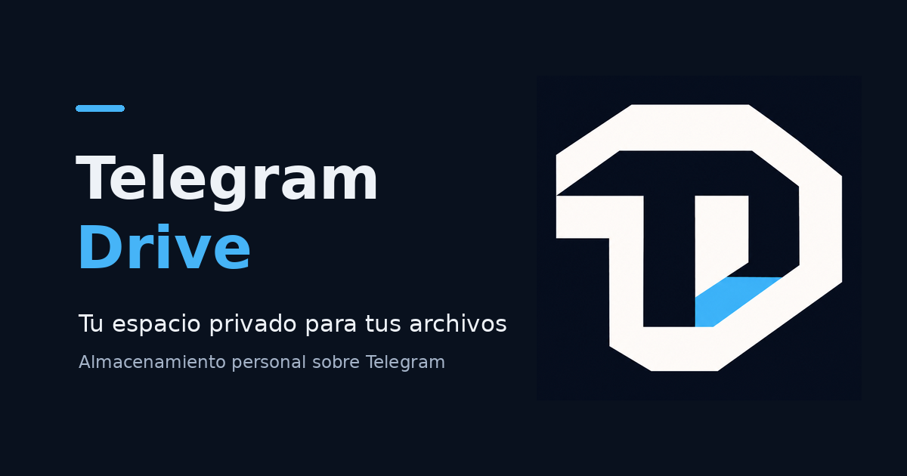

<p align="center"></p>

# TeleDrive (Telegram Drive)

Tu nube personal sobre tu canal privado de Telegram: **privada, sin límites y sin suscripción**. Instalable como **PWA** en iPhone,
Android y escritorio: carpetas, subida/descarga, música con biblioteca, vídeo, fotos con línea de tiempo y enlaces para compartir.

- **Telegram es la fuente de verdad; SQLite es solo una caché del índice** (`data/index.db`). Cada archivo se guarda como documento
  en tus *Mensajes guardados* con un pie `#tgdrive {"v":2,"t":"file","f":"<idCarpeta>","n":"nombre"}`; cada carpeta es un mensaje
  `#tgdrive {"v":2,"t":"folder","i":"<id>","p":"<idPadre>","n":"nombre"}`. Si borras `index.db`, se reconstruye solo.
- **Pensado para colecciones grandes**: las carpetas tienen id propio, así que renombrar o mover una carpeta con miles de archivos
  edita **un único mensaje**. El arranque es **incremental** (solo lee los mensajes nuevos), los listados se **paginan** con
  scroll infinito (300 por página, orden natural: "Pista 2" antes que "Pista 10") y la cola del reproductor abarca toda la carpeta.
- **Cuenta real (MTProto)** con [GramJS](https://github.com/gram-js/gramjs): hasta 2 GB por archivo (4 GB con Premium) y descargas
  sin el límite de 20 MB de la Bot API.
- **Música por carpetas y por etiquetas**: el botón ▶ de cada carpeta (y *Reproducir* / *Aleatorio* en su cabecera) reproduce toda su
  música, subcarpetas incluidas. Además, el servidor lee en segundo plano las etiquetas (ID3v2/ID3v1, Vorbis, MP4) descargando solo
  el principio de cada archivo y las guarda en el índice: la sección **Biblioteca** agrupa por **álbumes, artistas y géneros**, ordena
  por disco y nº de pista y usa la portada incrustada. El reproductor tiene aleatorio y repetir (todo / una).
- **Cola, listas y sin conexión**: cola editable (reordenar, quitar, guardar como lista), reanuda la canción y la posición al volver,
  listas de reproducción (se guardan en Telegram, así que sobreviven a reconstruir la caché), búsqueda por etiquetas, duración de
  pistas, edición de etiquetas y fusión de artistas, y música guardada en el dispositivo para escuchar sin red.
- **Gestión**: selección múltiple (mover, ZIP, papelera, añadir a lista), descarga de carpetas en ZIP en streaming, **papelera de 30 días**
  (eliminar ya no borra al instante), enlaces temporales para compartir un archivo o una carpeta y aviso si Telegram deja de responder.
- **Orden de reproducción de una carpeta**: ▶ reproduce la carpeta y sus subcarpetas (primero la propia, luego cada subcarpeta por nombre).
  Dentro de cada carpeta: por nº de pista de las etiquetas; si no hay, por el número del nombre del archivo; si tampoco, aleatorio.
- **Edición masiva de etiquetas**: marca archivos con el check (y/o carpetas) → **Etiquetas**, o el menú de una carpeta → *Editar etiquetas de la carpeta*.
- **Streaming con `Range`**: audio y vídeo se pueden buscar (seek) sin descargar el archivo entero.
- **Más funciones** (cada una vive en su carpeta, ver `docs/ARCHITECTURE.md`): subidas en paralelo con reintentos y aviso de repetidos ·
  filtros por tipo, fecha y tamaño · arrastrar archivos sobre una carpeta para moverlos · atajos de teclado (`?` muestra la lista) ·
  letras de canciones (escritas o importadas de las etiquetas) · ecualizador de 5 bandas y fundido entre canciones · revisión de la
  biblioteca (álbumes incompletos, pistas repetidas, etiquetas incoherentes) · **Fotos** con línea de tiempo por fecha EXIF y enlace
  al mapa · álbumes de fotos · retomar vídeos donde se dejaron · **Espacio** (uso por tipo y carpeta) · enlaces compartidos con
  contraseña, caducidad y límite de descargas · **Seguridad** (registro de accesos, aviso de dispositivo nuevo) · copia de seguridad
  cifrada · compartir hacia la app desde Android.
- **Carpetas con personalidad**: cada carpeta puede tener **color** (20 tonos) e **icono** (más de 40, o *Sin icono*) desde su menú; el
  tono se reparte por toda la interfaz. El explorador alterna entre **cuadrícula** y **lista con columnas** (nombre, tipo, tamaño, fecha).
- **Reproductor a pantalla completa**: se abre tocando la barra (o deslizándola hacia arriba; hacia los lados cambia de canción). Carátula,
  osciloscopio y controles caben siempre en la pantalla, sin deslizar, en cualquier móvil (vertical y apaisado). Ver
  [Reproductor a pantalla completa](#reproductor-a-pantalla-completa).
- **Letras desde internet**: busca la letra (sincronizada si existe) en [LRCLIB](https://lrclib.net) al reproducir, a mano con un selector
  o para toda la biblioteca de una vez. Ver [Letras](#letras).
- **Configuración**: sección propia con los ajustes de la app que se guardan en el dispositivo (aspecto del reproductor, osciloscopio con
  vista previa, letras).
- **Inicio** en la barra superior (icono de casa) y **estados vacíos y esqueletos de carga** en todas las pantallas.
- **Frontend sin build**: HTML + CSS + módulos ES nativos. Cero dependencias en el navegador.

## Estructura

```
server/
  config/        Carga y validación de .env
  middleware/    Sesión (cookie firmada), rate-limit, cabeceras CSP, errores
  db/            database.js (SQLite: node:sqlite o better-sqlite3) · folder-tree.js · files-repo.js
  core/          events.js (bus interno) · notify.js (avisos por webhook)
  features/      UNA CARPETA POR FUNCIÓN: access-log · share-access · backup · duplicates · lyrics (+ LRCLIB) · library-audit ·
                 photos · photo-albums · usage · image-cache · music-downloads · cover-rescan  (index.js las registra)
  tools/         migrate-chat.js · restore-backup.js (usadas por los scripts)
  routes/        auth.js · drive.js
  services/      catalog.js (fachada) · folder-ops.js · file-ops.js · sync.js (incremental/completa)
                 streamer.js (Range) · uploads.js · thumbnails.js · records.js
  telegram/      service.js (único contacto con GramJS) · codec.js (formato del pie de mensaje)
  utils/         paths, crypto (scrypt/HMAC), errores, tipos de medio
assets/brand/    Imágenes maestras de la marca (icono cuadrado y portada); de ellas salen todos los iconos
docs/            ARCHITECTURE.md
scripts/         setup.js · login.js · chats.js · migrate-chat.js · backup.js · restore.js · generate-icons.js · check.js
public/
  index.html · manifest.webmanifest · sw.js · offline.html · icons/
  css/           tokens → base → components → layout → explorer → players → lightbox
  js/core/       api · store · router · drive (datos) · dom (DOM seguro) · icons · format
  js/ui/         topbar · explorer · actions · modal · menu · login · toast …
  js/features/   uploads · filters · dragmove · shortcuts · lyrics · audio-fx · library-audit · photos · usage ·
                 video-resume · share-target · security · share-policy · now-playing (pantalla completa) · player-look ·
                 scope (osciloscopio) · waveform · settings (Configuración) · touch-gestures · music-downloads
  js/players/    audio-player · media-session · recovery · web-audio (grafo compartido) · video-player · lightbox · viewer (despacho por tipo)
  js/pwa/        registro del service worker e instalación
deploy/          nginx-telegram.conf · nginx-telegram-limits.conf · telegram-drive.service · deploy.sh
test/            Integración con un Telegram simulado (npm test) y servidor demo (npm run dev:fake; FAKE_SEED=650 para 650 pistas)
```

Regla de oro: ningún archivo de código supera ~220 líneas (`npm run check` lo verifica).

## Reproductor a pantalla completa

- **Diseño fijo**: arriba la carátula (o la letra, o la lista de reproducción), debajo el **osciloscopio**, el título, la barra de posición
  y los controles. Nada se desplaza; solo la letra y la lista tienen su propio scroll. Se sale con el botón de arriba a la izquierda (o `Esc`).
- **Botón de arriba a la derecha (Aspecto)**: elige qué ocupa el lugar de la carátula (carátula, letra o lista), muestra u oculta el
  osciloscopio y activa o no el disco giratorio, los colores de la carátula y la forma de onda. Incluye «Más ajustes…» y «Cerrar el reproductor».
- **Colores de la carátula**: el fondo y los botones toman el tono dominante de cada portada. **Disco giratorio**: la carátula gira mientras suena.
- **Letra sincronizada (LRC)**: resalta y sigue la línea que suena; tocar una línea salta a ese momento.
- **Barra de posición con forma de onda**: se dibuja a partir del propio audio (archivos de hasta 14 MB, una segunda descarga a los 2,5 s de empezar,
  picos guardados en el dispositivo) y se desactiva con el ahorro de datos.
- **Osciloscopio**: 5 tipos (onda, barras, circular, espejo y Lissajous estéreo), color (el de la carátula o 8 tonos) y sensibilidad,
  configurables en **Configuración** con una vista previa animada. Usa Web Audio, que solo se crea cuando se activa (ver Notas).
- **Imágenes para carpetas y carátulas**: una carpeta puede tener imagen de fondo (menú de la carpeta, o botón *Imagen* con varias seleccionadas); el icono y el color se mantienen y el borde toma el tono de la imagen. Las canciones sin carátula admiten una imagen propia (menú de la pista, o *Imagen* con varias seleccionadas) con la opción de sustituir las que ya tienen. En ambos casos hay recortador (cuadrado en canciones, a medida de la tarjeta en carpetas) con arrastre y zoom. Se guardan en el servidor, no en Telegram.
- **Carpetas del lateral arrastrables**: se pueden arrastrar y soltar unas sobre otras (o sobre *Inicio*) para moverlas, igual que las tarjetas.
- **Indicador «suena»**: sus tres barras siguen graves, medios y agudos de la música (en iPhone, sin análisis de audio, usan una animación suelta).
- **Gestos**: en la barra, deslizar hacia arriba abre la pantalla completa y hacia los lados pasa a la siguiente o anterior; en la carátula, lo mismo hacia los lados.
- **Reproducción en segundo plano y con la pantalla apagada**: Media Session (controles y carátula en la pantalla de bloqueo y en la
  *Isla dinámica* del iPhone, que iOS rellena solo a partir de ella), posición y salto de ±10 s, y recuperación del flujo si se corta
  (hasta 3 reintentos). El service worker solo interviene en la música guardada para uso sin conexión.

## Letras

- **Fuentes**: escritas a mano, importadas de las etiquetas del archivo o buscadas en [LRCLIB](https://lrclib.net) (base abierta, sin clave).
- **Automática**: al empezar una canción sin letra se busca sola (se desactiva en *Configuración → Letras*). Solo se guarda una coincidencia
  segura (título y artista parecidos y duración compatible); si no la hay no se guarda nada y no se vuelve a intentar en 30 días. Una letra
  que quitas a mano no se vuelve a poner sola.
- **A mano**: «Buscar en internet» (pantalla completa y panel de letras) abre un selector con las coincidencias, una vista previa y la
  marca *Sincronizada*; se puede afinar el texto de búsqueda.
- **Toda la biblioteca**: *Configuración → Letras → Buscar letras que faltan* recorre en segundo plano las canciones sin letra, con progreso
  y cancelación; se detiene sola si LRCLIB deja de responder.
- **Privacidad**: el servidor solo envía a `lrclib.net` el título, el artista, el álbum y la duración (con los «Remastered», «feat.», «Official
  Video»… ya limpiados del título); el texto de la letra lo descarga el propio servidor. Necesita salida HTTPS a `lrclib.net`.

## Marca e iconos

Las imágenes originales están en `assets/brand/` (`icon-master.png` cuadrada y `cover.png` apaisada). `npm run icons` regenera a partir de ellas:
iconos PWA de 48 a 512 px, **maskable** de 192/512 (Android adaptable: el motivo queda dentro de la zona segura), `apple-touch-icon`
(120/152/167/180 para iPhone y iPad), `favicon.ico` + PNG de 16/32/48, icono de mosaico de Windows, y `public/readme-cover.png`
(1200×630: cabecera del README y vista previa al compartir el enlace; el servidor pone la URL absoluta según el dominio).
Para la vista previa del repositorio en GitHub, sube `public/readme-cover.png` en *Settings → Social preview*.

## Puesta en marcha

Requisitos: Node.js ≥ 20 y credenciales de API en <https://my.telegram.org> → *API development tools*.

```bash
npm ci --omit=dev
npm run setup     # API ID/HASH, BASE_PATH y contraseña web  -> .env
npm run login     # inicia sesión en Telegram (teléfono + código + 2FA) -> data/telegram.session
npm run login:qr  # alternativa si el código no llega: escanea un QR desde Telegram > Ajustes > Dispositivos
npm start
```

Desarrollo de la interfaz sin Telegram: `npm run dev:fake` → <http://127.0.0.1:3199> (contraseña `demo-password`).

### Guardar en un grupo o canal privado

Por defecto los archivos van a *Mensajes guardados* (`TG_CHAT=me`). Para usar un grupo propio: `npm run chats` lista tus
grupos y canales con su ID; copia el del tuyo en `.env` como `TG_CHAT=-100…` y reinicia. Los archivos que ya estuvieran en otro chat se
copian al nuevo con `npm run migrate -- --from me --to -100… [--dry-run]` (no duplica lo que ya esté y no borra el origen).

### Copia de seguridad cifrada y restauración

Con `BACKUP_ENABLED=true` y `BACKUP_PASSPHRASE` (12+ caracteres) el servidor envía cada `BACKUP_EVERY_HOURS` horas una copia cifrada
(AES-256-GCM) de lo que **no** se puede reconstruir desde Telegram: enlaces compartidos, registro de accesos, letras, álbumes de fotos…
`npm run backup` la hace al momento y `npm run restore -- [archivo.tgb] [--out carpeta]` la descarga de Telegram (o abre el archivo indicado), la descifra y deja los datos en una carpeta (por defecto `restaurado/`). **Sin la frase no hay forma de abrirla.**

## Seguridad

- La web se protege con contraseña (scrypt) y cookie `HttpOnly`/`SameSite=Lax` firmada con HMAC. Limitador de intentos de login (los accesos correctos no cuentan). Segundo factor TOTP opcional: `npm run totp` y `APP_TOTP_SECRET`.
  Para una capa extra delante, ver `deploy/nginx-telegram.conf` (ejemplo con `allow`/`auth_basic` comentado).
- `data/telegram.session` equivale a tu cuenta de Telegram: permisos `600`, fuera de git y fuera del alcance web. **Sirve la app solo por HTTPS.**
- CSP estricta (`script-src 'self'`), sin HTML inyectado desde nombres de archivo, y `nosniff` en descargas.
- La API y los medios nunca se guardan en la caché del service worker (salvo la música guardada para uso sin conexión).
- Todo archivo servido se abre **aislado con `sandbox`** (sin scripts ni acceso a la sesión) salvo audio, vídeo, imágenes de mapa de bits y PDF:
  una lista blanca, porque una lista de tipos peligrosos siempre se queda corta (RSS, Atom, SVG…).
- Las descargas por URL directa solo admiten HTTPS a dominios públicos (IPv4 fijada, sin redirecciones), con tope de tamaño, de tiempo
  total y de inactividad.

## Caché fotográfica (10 GB)

- Los originales se conservan **únicamente en Telegram**. Descargar o «Guardar como» siempre entrega el archivo original, incluidos los metadatos.
- Las miniaturas (`data/thumbs/`) y vistas previas (`data/previews/`) se generan en **WebP** con Sharp, calidad 70/85 y tamaño máximo 360/2560 píxeles. Se crean bajo demanda, no se duplican en Telegram.
- Ambas carpetas reproducen la jerarquía de la app, por ejemplo `data/thumbs/Suki/Vacaciones/123.webp`. Se usa el ID de Telegram para evitar colisiones. Las miniaturas JPEG antiguas se migran automáticamente. Renombrar o mover carpetas/archivos mueve también su caché; la papelera invalida sus derivados.
- El límite de 10 GB es **compartido**; la limpieza automática elimina primero los archivos auxiliares menos utilizados, nunca los originales. Con Sharp ausente, el servidor puede recurrir a la miniatura de Telegram, pero para el despliegue se exige Sharp.
- El lightbox muestra la miniatura mientras obtiene la vista previa; al ampliar solicita el original. Así el primer acceso puede depender de Telegram, pero las siguientes visualizaciones usan el disco local.

## Descargas de música en MP3

La sección **Descargas** del menú permite elegir **Solo audio**, **Solo vídeo** o **Ambos** para enlaces de YouTube, Vimeo, Dailymotion y pistas de SoundCloud; las listas de YouTube (páginas de 50 elementos, hasta 5000 por lista). El servidor utiliza `yt-dlp`, FFmpeg y un entorno Python aislado. No hay límite de duración; cada archivo final tiene un máximo de **1 GB**. También incluye audio MP3/M4A/Opus, bitrate MP3 128/192/320 kbps, resolución de vídeo hasta 4K si existe en origen, organización de vídeos por canal/año/lista, subtítulos ES/EN cuando estén disponibles y prioridad de cola. Las opciones se guardan por descarga.

**Organización dentro de TelegramDrive (en Telegram, no en el disco):**

```text
Descargas de Internet/
├── Vídeos/
│   └── Concierto.mp4
├── Queen/
│   ├── A Night at the Opera/
│   │   └── Bohemian Rhapsody.mp3
│   └── Singles/
└── Por revisar/
```

La ruta raíz **Descargas de Internet** es exclusiva de las descargas desde YouTube. Los vídeos MP4 se guardan en **Vídeos/**, separados de la música MP3. Artista y álbum proceden de los metadatos; si no hay álbum se crea `Singles`, y si falta un artista fiable, `Por revisar`. La pantalla permite corregir título, artista y álbum antes de añadir una pista. Se evita volver a descargar un mismo ID de YouTube cuando su archivo sigue en TelegramDrive. Las tareas se registran en SQLite, con barra de progreso, reintentos y cancelación; los archivos temporales se eliminan tras finalizar.

Las carpetas se crean mediante las operaciones normales de TelegramDrive, el archivo MP3 se sube a Telegram y aparece en la biblioteca musical. Descargar/convertir MP3 **no mejora la calidad del audio de origen**. Utiliza esta función únicamente con contenido que tengas permiso para descargar; no elude DRM ni restricciones de acceso.

**Instalación:** `bash deploy/deploy.sh` ejecuta `deploy/install-music-tools.sh` en el VPS Ubuntu, creando `data/tools/yt-dlp-venv` e instalando `yt-dlp[default]` y FFmpeg. Para actualizar manualmente el motor: `UPDATE_MUSIC_TOOLS=1 bash deploy/install-music-tools.sh`. Para el soporte EJS de YouTube se recomienda Node >= 22.6. Los binarios se instalan fuera del repositorio, nunca en GitHub.

## Desarrollo y calidad

`npm test` ejecuta primero **ESLint** (`npm run lint`: variables sin definir, imports duplicados, código muerto…) y después las pruebas de
integración contra un Telegram simulado. Un test propio (`client-imports`) comprueba que cada `import` del cliente apunta a un fichero que
existe y exporta lo que se pide, y que `index.html` solo enlaza ficheros existentes: un import roto deja la pantalla en blanco y ningún otro
test lo vería. `npm run dev:fake` simula también LRCLIB, de modo que las letras se pueden probar sin red.

## Despliegue

Ver `deploy/`. Resumen: `bash deploy/deploy.sh` y bloque `location /telegram/` de Nginx (`deploy/nginx-telegram.conf`).

## Notas y límites

- **Primera sincronización**: indexar miles de archivos tarda unos minutos (la barra inferior muestra el progreso). Después, cada
  arranque solo lee lo nuevo. El botón **Sincronizar** hace una pasada completa y poda lo que hayas borrado a mano en Telegram
  (si Telegram no devolviera nada, el índice se conserva por seguridad). Protección contra borrados masivos: si faltan más de la
  mitad de los elementos (con 20 o más en el índice) no se poda nada y aparece un aviso con el botón «Quitarlos de la lista» para confirmarlo.
- **Etiquetas de música**: se leen una sola vez por archivo (la barra superior indica cuántas quedan). Los archivos sin etiquetas legibles
  siguen en sus carpetas pero no aparecen en la Biblioteca. Una base de datos anterior se migra sola al arrancar.
- SQLite: se usa el integrado de Node ≥ 22.5; con Node 20/22.0–22.4 se usa `better-sqlite3` (dependencia opcional).
- Subir una colección grande: sube la carpeta entera con **Subir → Subir carpeta**; las subidas van de 3 en 3, con reintentos si se corta la conexión.
- **Fotos**: la línea de tiempo lee el EXIF de los JPEG en segundo plano (solo la cabecera de cada uno); PNG, HEIC y similares se
  ordenan por su fecha de subida. El mapa es un enlace a OpenStreetMap: la CSP impide cargar teselas dentro de la app.
- **Ecualizador**: usa Web Audio y está desactivado por defecto; en iPhone/iPad puede cortar la música con la pantalla bloqueada. El
  fundido es «baja al final, sube al principio» (no solapa canciones) y no tiene efecto en iOS, donde el volumen es de solo lectura.
- **Compartir hacia la app** solo funciona en Android/Chrome con la PWA instalada (iOS no admite *share target*).
- **Límite de 48 h de Telegram**: Telegram no deja editar mensajes de más de 48 horas, y *enviar a la papelera* edita el pie del archivo. Para
  esos archivos la app ofrece **eliminarlos definitivamente** (con confirmación) en lugar de mandarlos a la papelera. Renombrar o mover archivos
  tan antiguos sí falla con un aviso; las carpetas no tienen este problema porque se republican.
- **Reproducción en segundo plano**: iOS puede cerrar una PWA en segundo plano y no hay API web para la *Isla dinámica* (la alimenta el
  sistema con Media Session). Con la pantalla bloqueada, el **ecualizador y el osciloscopio** (Web Audio) pueden cortar el sonido en iPhone y
  iPad: por eso el osciloscopio pide confirmación en iOS y el grafo de audio no se crea hasta que se activa alguno de los dos.
- **Forma de onda**: descarga una segunda vez la canción (≤ 14 MB) para dibujarla; las canciones que el navegador no sabe decodificar se
  descartan y no se reintentan en la sesión.
- **Arrastrar archivos desde el sistema**: el aviso «Suelta para subir» desaparece solo al dejar de arrastrar, con `Esc` o al tocar la pantalla.
- Las miniaturas de vídeo dependen de las que genere Telegram para cada documento.
- Los formatos que el navegador no reproduce (p. ej. MKV/HEVC) se pueden descargar desde el propio reproductor.
